# TP 1 : Les sockets en mode connecté TCP
## Activité 1-1 : Première connexion Client/Serveur

### Objectif

L'objectif de cette activité est d'établir une communication entre un client et un serveur en Java à l'aide des sockets en mode connecté TCP.

### Étape 1 : Préparation de l'environnement Git

Nous avons vérifié l'installation de Git avec la commande :

git --version

Cette commande permet d'afficher la version de Git installée.

### Étape 2 : Préparation de l'environnement Java

Nous avons vérifié la version de Java avec la commande :

java --version

Nous avons ensuite préparé le répertoire de travail ChakerRoua_LSI3_DevAppReparties.

### Étape 3 : Création du serveur

Nous avons créé un projet Java nommé TP1-DAR2026 dans IntelliJ IDEA.

Dans le répertoire src, nous avons créé le package serverPackage contenant la classe Server.java.

Le serveur utilise ServerSocket sur le port 5000 et la méthode accept() pour attendre la connexion d'un client.

Résultat attendu :

Je suis un serveur en attente la connexion d'un client

Interprétation :

Le serveur est démarré et reste en attente jusqu'à ce qu'un client demande une connexion.

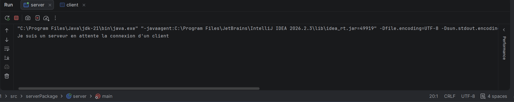

### Étape 4 : Création du client

Nous avons créé le package clientPackage contenant la classe Client.java.

Le client utilise la classe Socket pour se connecter au serveur à l'adresse localhost sur le port 5000.

Résultat attendu côté client :

Je suis un client pas encore connecté...
je suis un client connecté

Résultat attendu côté serveur :

Je suis un serveur en attente la connexion d'un client
un client est connecté

Interprétation :

Le client établit une connexion TCP avec le serveur. Dès que la connexion est établie, les deux applications affichent les messages de confirmation. Les sockets sont ensuite fermées.

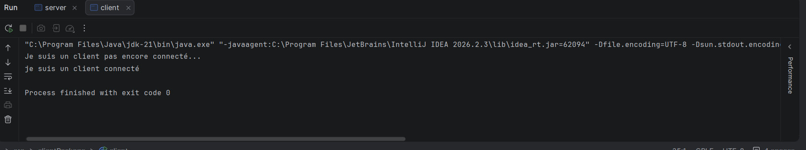

Connexion acceptée par le serveur
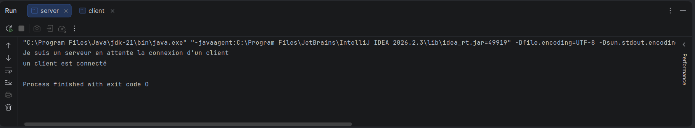

Remplacement de localhost par une adresse IP

Nous avons récupéré l'adresse IPv4 de la machine serveur avec la commande :

ipconfig

Nous avons ensuite remplacé localhost par cette adresse IP dans le code du client.

Socket socket = new Socket("192.168.1.14", 5000);
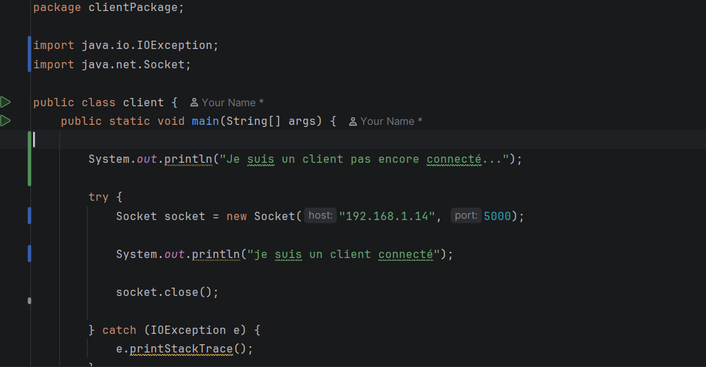

Le client peut ainsi se connecter au serveur à l'aide de son adresse IP.
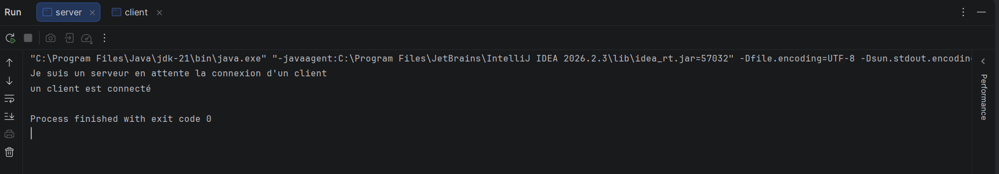
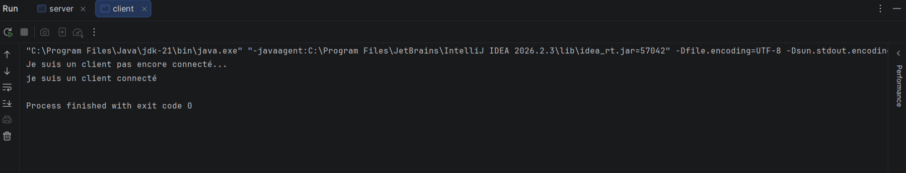

### Étape 5 : Dépôt des livrables

Le projet tp1 est destiné à être publié dans un repository GitHub contenant les codes Java, les captures d'écran et le fichier README.

https://github.com/rouachaker/tp1

### Conclusion

Cette activité nous a permis de comprendre le fonctionnement de la communication Client/Serveur en Java à travers les sockets TCP. Nous avons appris à créer un serveur, établir une connexion cliente et fermer les sockets après la communication.

## Activité 1-2 : Service de calculatrice

## Étape 1 : Préparation de l'espace de travail

Création des fichiers Client.java et Serveur.java
pour réaliser une application client/serveur TCP.

## Étape 2 : Service de multiplication

### 1. Application Serveur

Le serveur écoute sur le port 1234, attend une
connexion, reçoit un entier et le multiplie par 5.
Il renvoie ensuite le résultat au client.

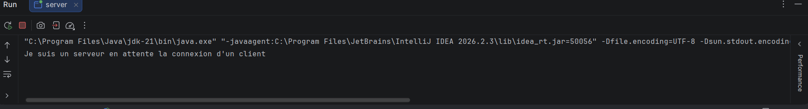

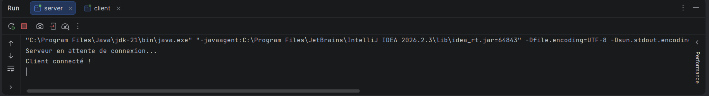

### 2. Application Client

Le client se connecte au serveur, demande un
entier à l'utilisateur, puis envoie cet entier.
Il reçoit le résultat et l'affiche.

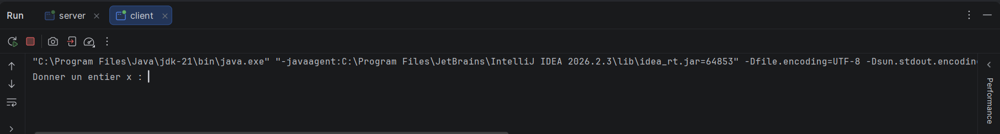

### 3. Résultat

Pour x = 4, le serveur calcule 5 * 5 = 25.
Le client reçoit et affiche le résultat 25.

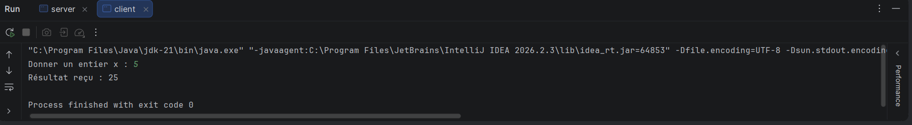
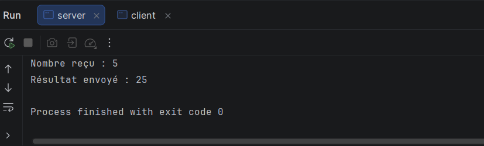

## Activité 1-3 : Amélioration sur le service de calculatrice

### Objectif

Améliorer l'application Client/Serveur de l'activité 1-2 afin de permettre une connexion entre deux machines distinctes du même réseau local et de proposer quatre opérations mathématiques.

### Étape 1 : Connexion entre deux machines

Nous avons utilisé les classes `InetAddress` et `InetSocketAddress` pour configurer l'adresse IP et le port de communication.

Le serveur écoute les demandes sur son adresse IPv4 et sur le port 5000.

Le client utilise l'adresse IP du serveur afin d'établir une connexion TCP.

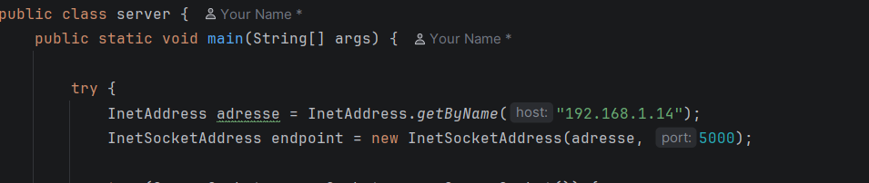

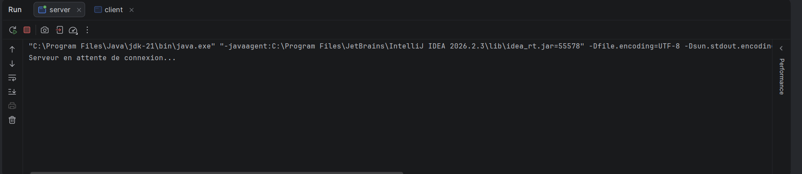

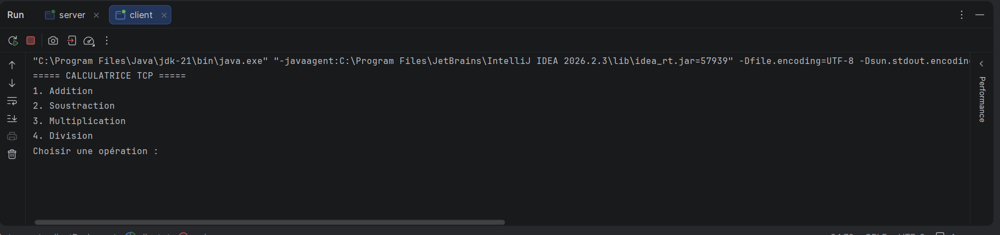

### Étape 2 : Amélioration de la calculatrice

Nous avons ajouté un menu contenant quatre opérations : addition, soustraction, multiplication et division.

Le client saisit une opération et une valeur `x`, puis transmet ces informations au serveur.

Le serveur effectue le calcul avec la valeur 5 comme deuxième opérande et renvoie le résultat au client.

### Tests effectués

| Opération | Valeur x | Résultat attendu |
|---|---:|---:|
| Addition | 6 | 11 |
| Soustraction | 6 | 3 |
| Multiplication | 6 | 30 |
| Division | 6 | 1.2 |

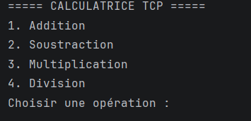

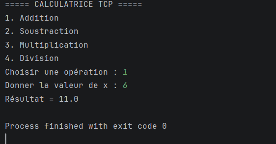

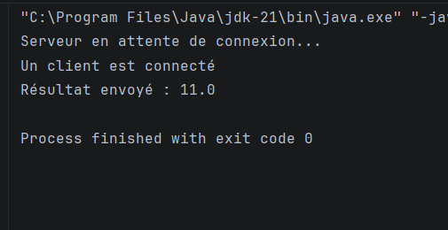

### Conclusion

Cette activité nous a permis de comprendre la communication TCP entre deux machines distinctes et d'améliorer une application répartie en ajoutant plusieurs services de calcul exécutés côté serveur.

